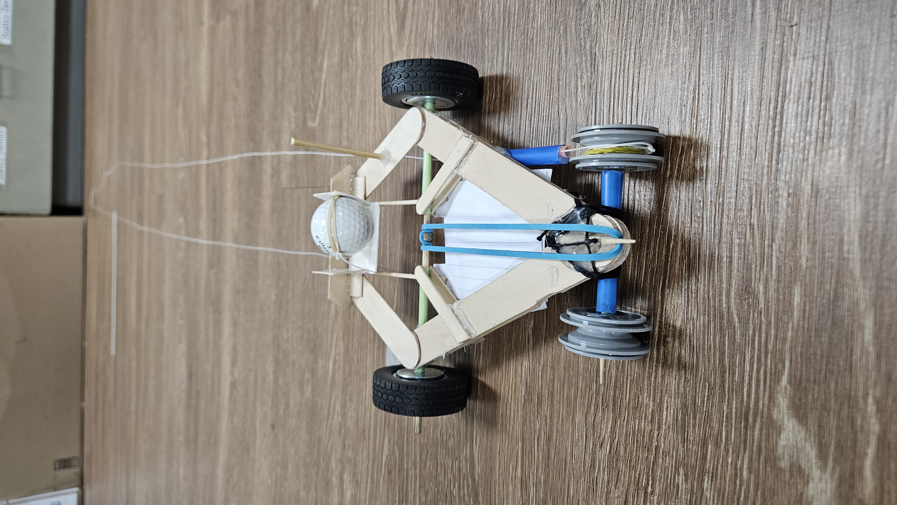

  <h1 style="border-bottom: none;"><u>Matthew Turner</u></h1>
  <h3 style="border-bottom: none;"> NCAS Career Portfolio</h3>

 

  <h2>Executive Summary</h2>
  
 My current career focus is Electrical Engineering, a field that O*NET defines by core competencies in circuit design, systems analysis, electrical testing, complex problem-solving, and software tools such as C++, MATLAB, and CAD, supported by a bachelor’s degree and credentials like the Fundamentals of Engineering (FE) exam and Professional Engineer (PE) license.1 My community college coursework and hands on projects directly build this foundation. EGR 121: Foundations of Engineering developed my teamwork, iterative prototyping, and constraint-driven design skills, while EGR 125: Introduction to Programming for Engineers strengthened my C++ algorithmic logic and software verification abilities, which are skills essential for designing and testing reliable electrical systems. My electrical engineering trajectory aligns directly with mission-critical workforce priorities outlined by NASA Force, which recruit technical talent to advance lunar surface systems, avionics, flight software, autonomous rovers, and propulsion technologies for Artemis and commercial spaceflight.2 By combining foundational engineering coursework with software and hardware prototyping, I am preparing to contribute to NASA’s exploration missions and the broader aerospace industry.
 

  <h2>Technical Skills</h2>
  <ul>
    <li>MATLAB (Engineering 121)</li>
    <li>C++ Programming (Engineering 125)</li>
    <li>Mathematical Reasoning (Calculus 1)</li>
    <li>Technical Communication (English 112 and Engineering 121)</li>
    <li>Electrical Troubleshooting (using schematics and test equipment)</li>
    <li>Electronics Test Equipment Proficiency</li>
</ul>

  <h2>Projects and Experiences</h2>
  <table>
  <tr>
    <td>
      
    </td>
    <td>
      <h3>Rubberband Powered Car</h3>
      
As part of a four-person engineering design team for my EGR 121 Foundations of Engineering class, we built a rubberband powered car capable of traveling 10 to 25 feet and dropping a golf ball onto a 6-inch diameter target, all while weighing under 1 lbs.   Aligns with NASA mass-constrained design (SWaP) and mechanical payload deployment. Calibrating string length to trigger an exact 6-in. target drop without electronics demonstrates aerospace kinematics, reliable fail-safe mechanisms, and iterative verification testing.3

    </td>
  </tr>
  <tr>
    <td>
      
    </td>
    <td>
      <h3>C++ Program to Calculate the Roots of a Quadratic Equation</h3>
      
Developed a C++ program for EGR 125 Intro. to Programming for Engineers that computes the real and complex roots of quadratic equations. Implemented user input validation, discriminant logic, and formatted console output to ensure accurate, crash free mathematical calculations.
   Aligns with NASA and aerospace industry reliance on C++ for realtime simulation, trajectory modeling, and flight software. Implementing edge case validation and numerical root-solving builds foundational skills in safety critical software engineering and verification.4

    </td>
  </tr>
</table>

  <h2>Resume</h2>
  <object data="resume/resume.png" type="application/pdf" width="80%" height="600px">
    
Your browser does not support inline PDFs. <a href="resume/Sample_Engineering_Resume.pdf" target="_blank">View the resume here</a>.

  </object>

  <h2>References</h2>
  
1 National Center for ONET Development, "17-2071.00 - Electrical Engineers," ONET OnLine, 2026. [Online]. Available: https://www.onetonline.org/link/summary/17-2071.00

2 National Aeronautics and Space Administration (NASA), "NASA Force," NASA Careers, 2026. [Online]. Available: https://www.nasa.gov/careers/nasaforce/

3 National Aeronautics and Space Administration (NASA), NASA Systems Engineering Handbook, NASA/SP-2016-6105 Rev2, Washington, DC, USA, 2016. [Online]. Available: https://www.nasa.gov/reference/systems-engineering-handbook/

4 S. Hughes, L. Jun, and W. Shoan, C++ Coding Standards and Style Guide, NASA Goddard Space Flight Center, Greenbelt, MD, USA, NTRS Doc. ID 20080039927, 2005. [Online]. Available: https://ntrs.nasa.gov/citations/20080039927

 

  
| maturner99@outlook.com | github.com/maturner5 | Blacksburg, VA |

